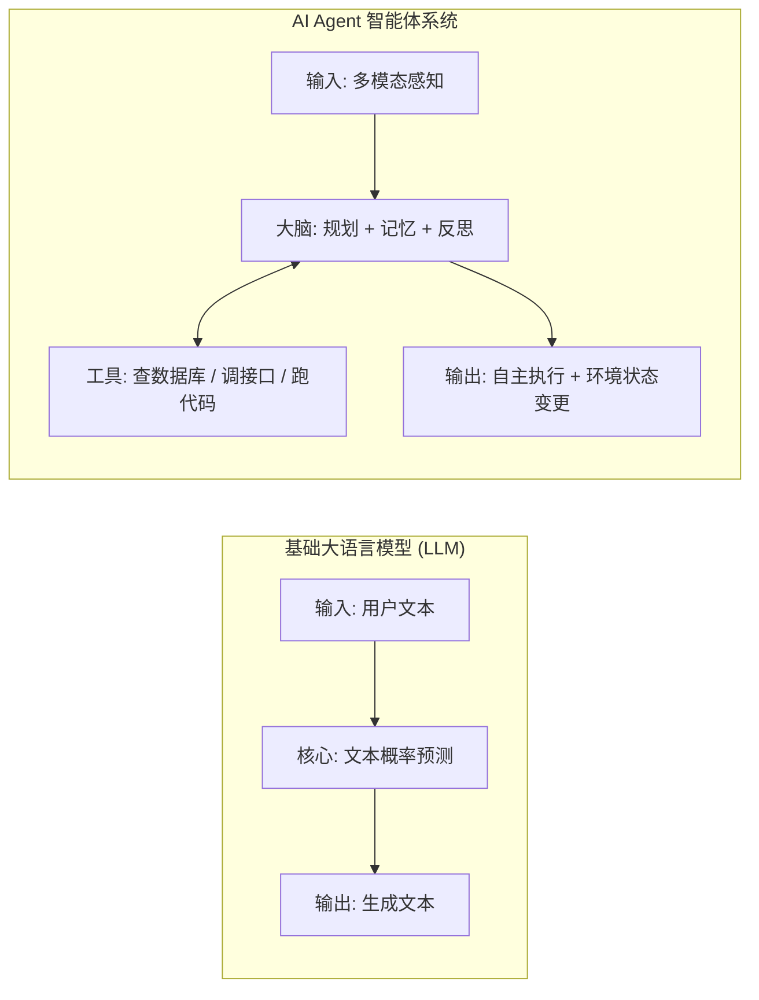
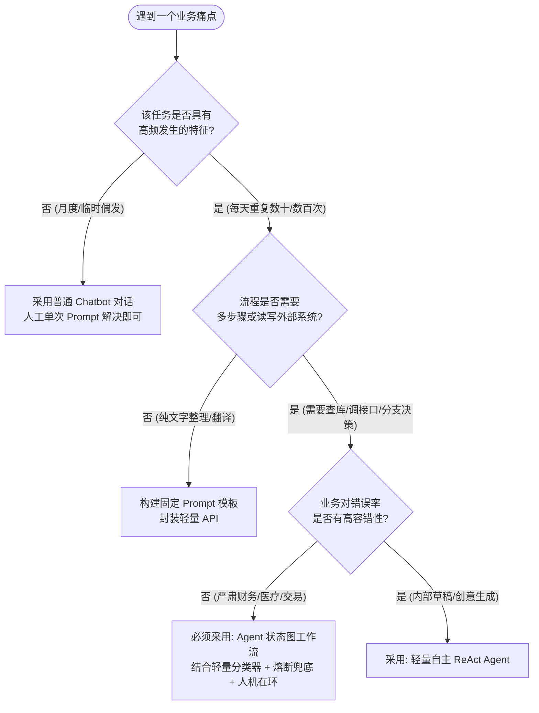
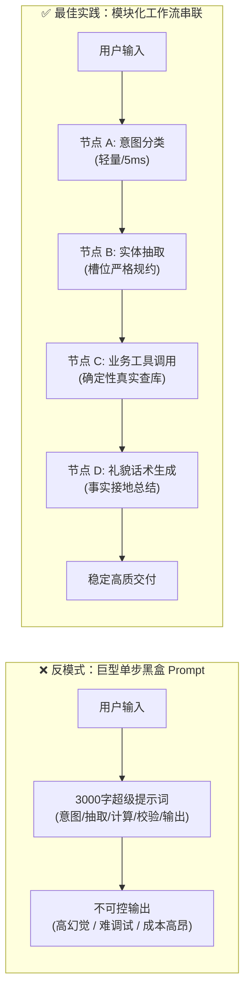
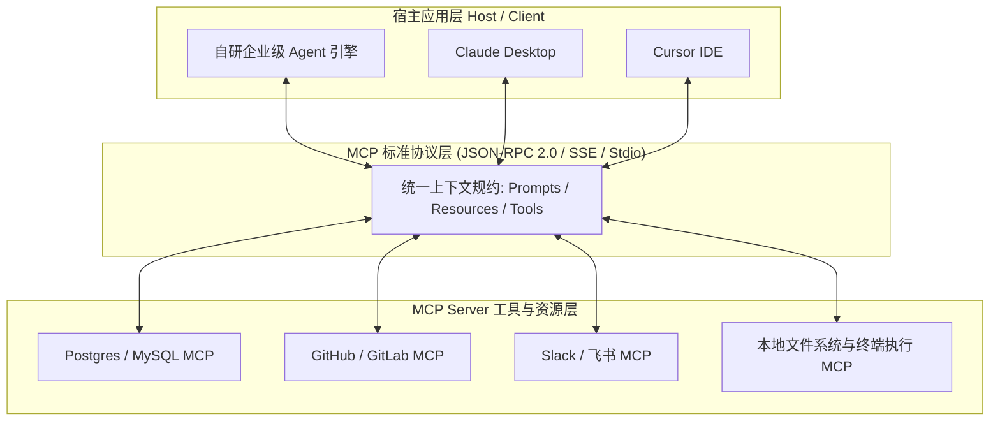
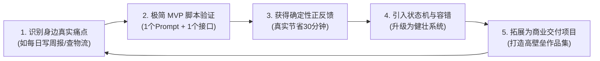

# 从零开始，理解 AI Agent

[翻阅本章手绘知识卡](/courses/ai-agent.html?chapter=01-mindset)

第 01 章 · 入门认知 · 无需编程基础

“帮我查一下订单到哪了，如果配送异常，就整理一份客服处理建议。”

这句话里，有目标、有外部数据，还有根据结果再做判断的步骤。本章就从这个小任务出发，弄清楚 Agent 是什么，以及什么时候值得搭建它。

::: tip 先记住这一句
<mark>Agent 根据目标选择行动，再根据行动结果决定下一步。</mark> 模型负责判断，程序负责执行，工具结果负责提供依据。
:::

::: info 读完这一章，你能做什么
- 分清普通对话、固定工作流和 Agent 的边界。
- 把一个业务需求拆成输入、步骤、输出与验收条件。
- 写出自己的第一个 Agent 任务卡，为后面的实操做准备。
:::

---

## 一、 什么是 AI Agent？

### 1.1 生活化通俗比喻
把模型想成一位能读懂问题、给出建议的助手。没有接入订单系统时，它能解释“如何查询物流”，却拿不到你的真实订单。

给它接上查询工具，再安排一个“判断 → 执行 → 查看结果”的循环，它就能推进任务：先确认订单号，查询物流；看到异常后，再查询处理规则，整理建议。

这里的关键不是聊天界面，而是**谁决定下一步、决定依据是什么、动作由谁执行**。一个聊天产品也可以在后台运行 Agent；给模型接一个工具，也不意味着必须搭建复杂的自主系统。

### 1.2 核心定义对照表

| 维度 | 固定程序 / 工作流 | 单次模型调用 | Agent 循环 |
| :--- | :--- | :--- | :--- |
| **下一步由谁决定** | 预设代码与分支规则 | 本次输入决定本次输出 | 模型结合目标与反馈选择 |
| **订单查询例子** | 按固定顺序查单、套模板 | 根据给定资料生成说明 | 缺订单号先追问，异常再查政策 |
| **外部能力** | 可以直接调用 API 和数据库 | 取决于宿主提供的数据和工具 | 通过已授权工具获得数据或执行动作 |
| **失败如何处理** | 编写异常处理与重试分支 | 校验输出，补资料或重试 | 同样需要超时、步数限制和人工接管 |

::: info 一次任务，拆开来看
1. **输入**：“订单 A1001 一直没动静。”
2. **行动**：调用订单查询工具，拿到“运输异常”的记录。
3. **反馈**：根据异常类型，检索对应的客服处理规则。
4. **输出**：说明当前状态、引用处理规则，给出下一步建议。

如果接口超时，系统应明确说“暂时查不到”，并按设定次数重试或交给人工。不能把“已发起查询”当作“已查到结果”。
:::

---

## 二、 什么时候需要 Agent？

### 2.1 先看任务里有什么变化
1. **表达会变**：同一个“换货”意图，用户可能说“太大了”或“想换个小号”。模型可以帮助理解表达，业务规则仍由程序校验。
2. **步骤会变**：订单正常时解释进度，异常时查处理规则，缺信息时追问。下一步需要利用刚刚得到的结果。
3. **动作有边界**：查询订单和提交退款不是同一种权限。真正会修改业务数据的步骤，要在执行前完成授权与参数校验。

### 2.2 从最简单的方案开始
只需润色一段文字时，先用一次模型调用；步骤固定时，用工作流；需要根据环境反馈不断调整步骤时，再考虑 Agent 循环。

这个划分参考 [Anthropic 的工作流与 Agent 说明](https://www.anthropic.com/engineering/building-effective-agents)。它是帮助选型的视角，实际应用可以组合使用。

---

## 三、 常见场景：输入、动作与结果

| 场景 | 用户输入 | 系统需要做的事 | 怎么判断完成 |
| :--- | :--- | :--- | :--- |
| **订单客服** | “订单什么时候到？” | 查订单、查物流、解释异常 | 状态与接口记录一致 |
| **知识库助手** | “这款商品能退吗？” | 查政策、核对商品条件、引用依据 | 回答有来源，缺信息时追问 |
| **资料研究** | “比较这三个产品” | 拆问题、查资料、核对冲突信息 | 每个关键结论能追溯到来源 |
| **代码助手** | “修复这个报错” | 读代码、修改、执行相关测试 | 原问题不再出现，测试通过 |

以上是任务设计示例。效果要用自己的测试集和业务数据衡量，不能从架构图直接推导成功率或降本比例。

---

## 四、 动手前的五个设计问题

在动手写第一行代码前，建立严谨的工程思维是保证项目不烂尾的前提。

### 4.1 心法一：精准定位问题属性（一次性需求 vs 高频固定流程）

不是所有场景都需要 Agent。新手请严格按照下方的**场景筛选决策树**进行评估：

### 4.2 心法二：任务流程化整为零（从单节点打磨到工作流串联）

- **反模式**：写一个包含 20 条约束的巨型 Prompt：“你既要分析客户语气，又要提取订单号，还要计算运费，最后用表格输出”。
- **工程解法**：将复杂的单步大模型推理拆解为相互解耦的管道流。

- **核心好处**：每个节点均可独立编写单元测试，哪个环节出错一清二楚，系统调试成本降低 90%。

### 4.3 心法三：善用平台工具与标准协议

- **拒绝从零造轮子**：
  - 验证原型（MVP）阶段，优先使用 **Dify** 或 **Coze**，几小时内即可完成知识库挂载与工作流验证；
  - 跨系统工具接入阶段，拥抱 **Anthropic MCP（Model Context Protocol）** 协议，一次编写，多端复用；
  - 核心业务生产阶段，使用 **LangGraph** 或字节开源的 **Eino** 进行强类型代码级控制。

### 4.4 心法四：提示词是系统的业务配置代码
提示词（Prompt）绝不是随性写就的“小作文”，而是工业级 Agent 的业务配置规约。一个生产级 Prompt 必须包含四大核心骨架：
1. **Role & Identity**（角色与专业权威定义）
2. **Workflow & Constraints**（执行流程与严格边界，明确禁止做什么）
3. **Few-Shot Examples**（少样本示例，尤其是异常与边界输入）
4. **Output Schema**（强制约束输出格式，推荐强类型 JSON）

### 4.5 心法五：先以自用为主的敏捷进阶
不要试图第一天就开发一套颠覆行业的超级系统。建议从身边的真实痛点起步：
- 例如：写一个“每日 GitHub 提交自动生成周报的 Agent”；
- 或者：“本地 Markdown 读书笔记精准检索问答 Agent”。
当工具在现实中真正为你节省了 30 分钟时间，你所获得的确定性正反馈将驱动你快速突破后续的复杂架构。

---

## 五、 两个常见问题

### Q1：为什么我的 Agent 经常在中间某一步“自由发挥”，完全不理会我在提示词里的规则？
- **原因剖析**：提示词过长导致“注意力衰减（Lost in the Middle）”，或者多条约束之间存在逻辑冲突。
- **解决方案**：立即执行“化整为零”拆分，把长 Prompt 拆解为两个串联的 Node；同时对关键输出字段强制使用 JSON Schema 校验（如 Pydantic），阻断其自由发散。

### Q2：给大模型接入工具越多越好吗？
- **原因剖析**：工具描述重叠、名称含糊或参数复杂时，模型更容易选错；工具说明也会占用上下文。不存在适用于所有模型的固定工具数量上限，应实际评测。
- **解决方案**：引入**路由层（Router Pattern）**或**技能渐进式披露（Progressive Disclosure）**，先由分类节点缩小工具候选范围，再向具体智能体动态注入相关的 2~3 个工具。

---

## 六、 动手练习：写一张任务卡

先用下面的模板描述“订单异常处理助手”，再换成你自己的场景。

| 任务字段 | 示例 |
| :--- | :--- |
| 目标 | 查明订单当前状态，整理处理建议 |
| 输入 | 订单号、用户问题；缺订单号就追问 |
| 可用工具 | 只读订单接口、物流接口、售后政策检索 |
| 执行边界 | 不自动退款，不发送未经确认的消息 |
| 输出 | 订单状态、信息来源、建议、尚未解决的问题 |
| 停止条件 | 已得到答案；或工具连续失败，转人工 |

::: tip 验收：下面三种输入都能解释清楚
订单号齐全时怎么查？缺订单号时怎么问？查询失败时怎么结束？能说清这三条路径，就可以进入下一章。
:::

1. **场景定性练习**：请挑选你当前工作或生活中的 3 个场景（例如：发票报销初审、撰写朋友圈文案、代码 Bug 自动化定位），使用本章提供的决策树画出它们的定性分析流程图。
2. **化整为零拆解练习**：针对“客户要求退换购买的数码相机”这一售后场景，将其拆解为 4 个职责独立的最小原子功能节点，并定义每个节点的标准输入与输出数据结构。
